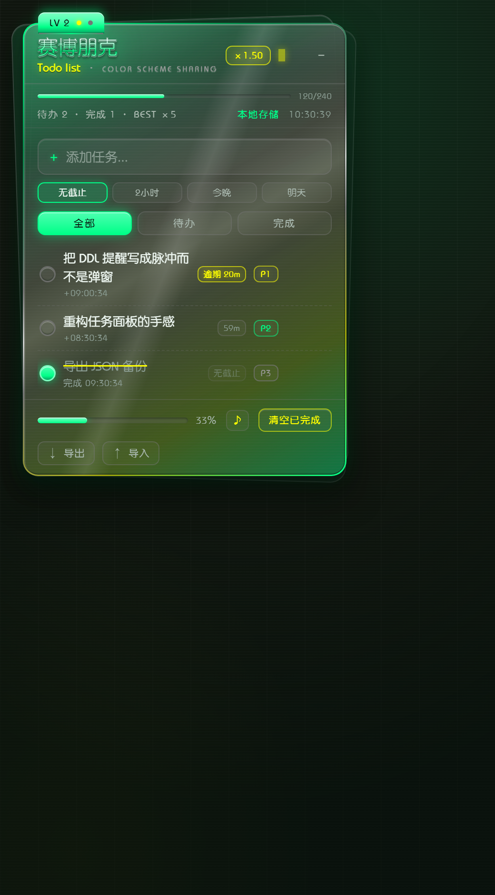
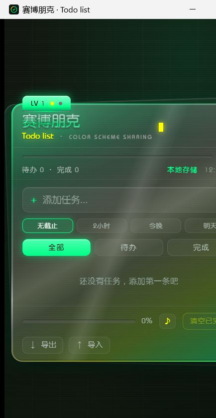

# 赛博朋克 · Todo list

一个高颜值的赛博朋克风 Todo 应用。同一套代码有三种形态：浏览器单文件、Windows 桌面程序（Tauri + WebView2）、DeepSeek Harness 插件。全部本地运行，零网络请求，零遥测。

<div align="center">
  
  
</div>

## 特性

- **HUD 圆球令牌**：收起时是角落里的一个悬浮球，外圈绿色圆环是当前等级的 XP 进度，中心数字是未完成任务数；逾期时变黄并脉冲报警。
- **文件夹卡片面板**：液态玻璃 + 金属包边 + 扫描线纹理，多张卡片层叠；展开收起、自由拖动，位置持久化。
- **游戏化**：完成任务按优先级掉 XP（10/15/25/40），升级有覆盖层动画和音效；120 秒内连击乘 ×0.25（上限 ×2）；重开同一任务不重复计分（防刷）。
- **DDL**：每行一个截止标签循环切换：无 / +2 小时 / 今晚 21:00 / 明天 21:00；过期任务行会亮报警脉冲。
- **优先级**：点标签在 P0–P3 间循环，影响掉落 XP；支持 ALL / ACTIVE / DONE 过滤与一键清空已完成。
- **音效**：击杀、升级、静音提示全部是 WebAudio 现场合成的（无音频文件），静音状态持久化。
- **备份**：面板底部 ↓导出 / ↑导入 JSON，换机迁移一秒钟。
- **配色**：严格三色——荧光绿 `#00ff88` / 灰 `#757575` / 荧光黄 `#ffff00`，无黑无蓝，暗色底。

## 三种形态

| 形态 | 目录 | 说明 |
| --- | --- | --- |
| Windows 桌面 | `dist/`（`tauri/` 为源码） | Tauri 2 + WebView2，免安装 exe 和 NSIS 安装包都有 |
| 浏览器单文件 | `standalone/todo.html` | 一个 HTML 文件，零依赖，双击即用，数据在 localStorage |
| DSH 插件 | `dsh-plugin/` | DeepSeek Harness 的悬浮球插件，数据落宿主 storage |

## 快速开始

**桌面版（推荐）**：下载 `dist/neon-tasks_1.0.0_x64-setup.exe` 安装，或直接用免安装的 `dist/neon-tasks.exe`。Windows 11 开箱即用；Windows 10 需要 [WebView2 Runtime](https://developer.microsoft.com/microsoft-edge/webview2/)（一般已随 Edge 装好）。

**浏览器版**：把 `standalone/todo.html` 拖进任意浏览器。

**DSH 插件**：见 `dsh-plugin/README.md`（bundle 补丁 + Plugin Manager 安装）。

## 玩法数值

| 项目 | 数值 |
| --- | --- |
| 击杀 XP | P0=10 · P1=15 · P2=25 · P3=40 |
| 升级 | 每级 120 XP，级数越高掉落越多 |
| 连击 | 两次击杀间隔 < 120s 算连击，每次 +×0.25，封顶 ×2 |
| 防刷 | 已完成的任务重开不算分 |

## 从源码构建（Windows）

前置：Rust（[rustup.rs](https://rustup.rs)）+ Visual Studio 2022 Build Tools（“使用 C++ 的桌面开发”工作负载）+ Node.js ≥ 20。

```bat
tools\build-tauri.bat    :: 编译 tauri\src-tauri\target\release\neon-tasks.exe
tools\build-nsis.bat     :: 打 NSIS 安装包（经 npx 调官方 Tauri CLI）
```

日常维护：

```bat
node tools\sync-frontend.js    :: 改了 standalone/todo.html 后同步进 tauri\src
node tools\verify-tauri.js     :: 静态校验（配置/图标/前端字节一致/脚本可解析）
node tools\make-icons.js       :: 重新生成全部图标（零依赖 PNG/ICO 编码）
node tools\standalone-check.js :: 前端行为回归（31 项，DOM shim）
node tools\browser-check.js    :: 真实浏览器回归（10 项，几何与 1s 心跳）
```

## 目录结构

```
├── standalone/         单文件 Web 客户端（事实前端，唯一需要改的 UI 源）
├── tauri/              Tauri 桌面壳（src/index.html 由 sync 生成）
│   └── src-tauri/      Cargo 工程、窗口参数、图标、capability
├── dsh-plugin/         DeepSeek Harness 插件（宿主路由 + 悬浮球客户端）
├── dist/               预构建产物（免安装 exe + NSIS 安装包）
├── screenshots/        截图
└── tools/              构建与回归脚本
```

## 数据与隐私

- 所有数据都在本机：桌面版在 `%LOCALAPPDATA%\com.neontasks.client\EBWebView`（localStorage），浏览器版在浏览器 localStorage，插件版在 DSH 的 `storages/neon_tasks.json`。
- 无任何网络请求：没有后端、没有埋点、没有 CDN。
- 备份：面板底部 ↓导出，换机后 ↑导入。

## License

[MIT](LICENSE)
